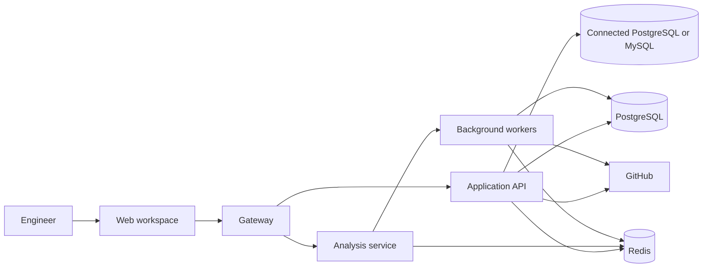

# Structrace: Product and Workflow Guide

Structrace turns a software repository and its connected database into an
explorable engineering workspace. It brings repository structure, dependency
relationships, change history, maintainability signals, security findings, and
database insight together so engineers can understand a system and make better
informed changes.

This guide describes the product from the first sign-in through repository
analysis, day-to-day exploration, collaboration, and database operations.

> **Implementation status:** This is both a user guide and a product
> specification. Some capabilities below are optional or have known limits.
> The [implementation assessment and roadmap](docs/PRODUCT_BLUEPRINT.md)
> records what the repository currently implements, what remains unverified,
> and which enhancements are proposed. A documented workflow is not by itself
> evidence that the production path has been exercised.

## Product Direction and Current Readiness

Structrace helps engineering teams build an evidence-backed understanding of
repositories and connected database schemas. The product should make it easy to
move from a question (for example, “what could this change affect?”) to
relevant files, relationships, findings, and a shareable explanation.

The current application already contains substantial repository exploration,
Git history, database visualization, security and quality analysis, saved
project state, and asynchronous processing. It is a working product foundation,
not yet a verified enterprise release. Important release gaps include the
absence of a completed end-to-end production deployment exercise, a current
dependency license inventory, a clean frontend lint baseline, versioned
application database migrations, and real organization invitation and SSO
flows. See the blueprint for the evidence and acceptance criteria.

### Capability status

| Status | Meaning in this guide |
| --- | --- |
| **Implemented** | Code and an existing audit or focused verification support the behavior. Production readiness may still need separate validation. |
| **Partial / limited** | Some code exists, but the workflow has a known product or operational limitation. |
| **Optional** | The feature depends on an external integration or configuration. |
| **Proposed** | A roadmap item; it must not be read as shipped behavior. |

| Capability | Current status |
| --- | --- |
| Repository analysis, exploration, Git insights, quality signals, exports, and saved project context | Implemented in the client and services; the latest audit did not complete a real GitHub-backed analysis run. |
| PostgreSQL/MySQL schema and telemetry surfaces | Implemented for supported sources; database telemetry was not fully re-verified in the latest recorded audit. |
| Password sessions, GitHub OAuth, project authorization, secret encryption, request limits | Implemented in the current Node API and gateway paths; see the security audit and release checks. |
| Organization access | Partial: organization and project membership data exist, but project-level roles and invitations are not a complete enterprise identity lifecycle. |
| OpenID Connect / SSO, SCIM, configurable RBAC, durable audit log | Proposed; not present as complete capabilities. |
| Pull request automation, AI explanations and Ask Codebase, scheduled digests | Optional integrations; availability depends on configuration and provider access. |
| Production deployment, backup recovery, full observability, supported upgrade path | Partial or unverified; operational procedures and release evidence are roadmap work. |

For implementation detail, prioritized work, technology and license decisions,
and release criteria, see [Product assessment and development blueprint](docs/PRODUCT_BLUEPRINT.md).

## Who Structrace Is For

- **Software engineers** getting oriented in an unfamiliar codebase or tracing
  the impact of a proposed change.
- **Engineering leads** reviewing ownership, architectural boundaries, project
  health, and accumulated maintenance risk.
- **Teams** coordinating analysis and database visibility across shared projects.

## The End-to-End User Journey

### 1. Sign in and connect GitHub

Users can create an account with a username and password or sign in through
GitHub when GitHub sign-in is configured. Connecting GitHub lets Structrace
show repositories the user can access and retrieve repository files for
analysis. Repository access is checked before protected repository content is
served.

### 2. Create or select a workspace and project

A workspace groups related projects. A project is the place where a repository,
its saved analysis, optional database connection, and project-level settings
come together. Members of an organization can collaborate in shared workspaces.
Project editing rights are limited to the project creator, project members, and
organization administrators.

### 3. Choose a repository

A repository can be supplied through a GitHub URL, a local folder, or a ZIP
archive. Before analysis, users can apply custom exclude patterns so generated
results focus on relevant parts of the codebase. GitHub repositories are
available subject to the signed-in user's access.

### 4. Start analysis

Structrace submits analysis as background work rather than making the browser
wait for a complete repository scan. The system validates and queues the job,
retrieves the repository, inspects its structure and source, and builds the
analysis results. The workspace can show job progress while the work runs.

Completed results are stored for later visits. Repository trees and file
content are cached as well, which reduces repeated GitHub requests and avoids
unnecessary work when users return to a project. Users can explicitly refresh
an analysis when they need current results.

### 5. Explore the results

The workspace presents several ways to understand the same repository:

- Start with the overview and its health indicators.
- Move through the architecture graph to see files, folders, and dependencies.
- Open file details to inspect source and related analysis evidence.
- Switch to history, ownership, quality, security, or database views when a
  specific question needs a different lens.
- Save useful views, bookmarks, and notes for future exploration or team
  context.

### 6. Track changes and follow up

Users can compare analyses over time, examine branch and pull request impact,
review ownership and activity, configure project alerts, and share project
context. For connected databases, the separate database visualizer provides
schema exploration and operational dashboards.

## How the System Works

Structrace uses a web client, a public-facing gateway, an application API, an
analysis service, background workers, and persistent data services. Each layer
has a distinct responsibility.

### Request and analysis lifecycle

1. **The web workspace** handles sign-in screens, repository selection,
   interactive graphs, dashboards, and user actions.
2. **The gateway** is the public API entry point. It applies request-size
   limits, rate limiting, concurrency limits, timeouts, cross-origin rules,
   health checks, and upstream routing.
3. **The application API** handles sessions, authorization, GitHub access,
   project and workspace data, saved state, database connections, telemetry,
   and other application features.
4. **The analysis service** accepts analysis requests and exposes job status.
   Long-running work is queued so the request can return without waiting for
   the full scan.
5. **Background workers** retrieve and inspect repository contents, derive
   structure and relationships, calculate findings, and make results available
   to the workspace.
6. **PostgreSQL** stores durable account, project, analysis, cache, saved-view,
   annotation, coverage, and history data.
7. **Redis** supports shared sessions, job queues, job state, and short-lived
   operational data.
8. **The client polls job status** until analysis is complete, then displays
   the stored results. Later visits can reuse stored analysis and cached
   repository data.

The gateway routes analysis requests to the analysis service and routes
authentication, project, GitHub, and database operations to the application
API. Analysis requests that involve repository retrieval are also subject to
authentication and repository-access checks.

## Repository Workspace Features

### Overview and health

The overview is the entry point for understanding repository condition. It
summarizes analysis results, risk indicators, and prioritized follow-up areas
so users can decide where to explore next.

### Interactive repository explorer

The graph connects files and their dependencies and can be navigated, filtered,
grouped, and inspected at different levels.

| Graph mode | What it shows | Useful for |
| --- | --- | --- |
| **Tree** | A radial view of the nested folder hierarchy. | Getting oriented in the repository and finding areas by location. |
| **Bundle** | A circular, folder-grouped view of dependency connections. | Spotting cross-folder and cross-cutting relationships. |

Users can group graph content by folders and architectural layers, search for
files, focus on related portions of the graph, and drill into individual files.
File details connect source content to relevant relationships and findings.
Graph and file exploration can be supplemented with bookmarks, saved views,
notes, and annotations.

### Architecture

The architecture view groups modules and displays their dependencies. When
optional AI configuration is available, Structrace can add generated
explanations to a validated architecture graph. Generated explanations do not
change the graph's underlying topology or identifiers.

Architecture rules can identify dependency relationships that violate defined
layering expectations. Architecture impact analysis can compare results and
show newly introduced or resolved layer violations.

### Git history, contributors, and ownership

Git insights help answer who changed what, when it changed, and where knowledge
is concentrated:

- **Branches:** compare development lines and inspect divergence.
- **Commits:** explore activity over time.
- **People:** review contributor distribution and engagement.
- **Ownership:** see file ownership derived from commit history.
- **Blame and heatmaps:** locate areas of activity and change concentration.
- **Releases:** generate structured release notes.
- **Pull request impact:** examine the likely blast radius of proposed changes,
  including affected files and architectural signals.
- **Pull request review:** request a risk-oriented assessment for a pull
  request. Automatic reviews can also be queued from GitHub events when the
  GitHub App integration is configured.

### Security analysis

Security findings include dependency and code-level vulnerability analysis.
Findings are surfaced in the workspace and associated with affected repository
content when available. Dependency vulnerability checks use external
vulnerability data; optional integrations may require configuration.

### Patterns and architectural signals

Pattern analysis identifies recurring design patterns and anti-patterns.
Related graph and architecture signals help users inspect dependencies,
architectural rule violations, and circular relationships.

### Quality and maintainability

Quality tools help teams identify areas that may need attention:

- **Technical debt:** rank maintenance hotspots by estimated cost.
- **Stale code:** highlight aging areas that may be less actively maintained.
- **Trends:** track repository health measures over successive analyses.
- **Coverage:** associate imported test-coverage data with repository files
  and identify risk where low coverage overlaps with important or changing code.
- **Unused code:** identify unused functions and support a cautious cleanup
  plan.
- **Cycles:** find circular dependencies and review possible ways to reduce
  them.
- **Endpoints and packages:** inspect detected API endpoints and package
  structure.
- **Architecture rules:** define or review expected dependency boundaries.

Coverage information can be loaded from supported coverage report formats.
Only per-file line totals are needed to associate coverage with the repository
analysis.

### Pull request and change review

Pull request impact analysis helps estimate which files and architectural
relationships are affected by a proposed change. Comparison surfaces can
highlight additions, removals, large-file changes, new rule violations, and
resolved issues. An optional review integration can generate a review for a
pull request, and a configured GitHub App can queue reviews automatically for
supported pull request events.

### Ask the codebase and reports

The workspace includes an Ask Codebase experience when the optional AI service
is configured. Users can also generate reports from analysis results and
export supported views for sharing or further use.

## Step-by-Step: Use the Repository Workspace

The workspace navigation is organized into **Overview**, **Explore**,
**Insights**, **Architecture**, **Security**, **Patterns**, **Actions**, and
**Quality**. Select a module to open it; where a module contains multiple
tools, choose the tool from its expanded list. Tools that need repository
results become available after analysis has completed.

### Start, refresh, and configure a repository analysis

1. Sign in and open the repository selection flow.
2. Choose a repository source: a GitHub repository, a local folder, or a ZIP
   archive.
3. If you do not want some directories or files included, open the exclude
   pattern controls and add the patterns to skip.
4. Start the analysis and wait for its progress to complete.
5. Open **Overview** to review the resulting health and risk summary.
6. To refresh the result later, open **Settings** from the account menu and
   select **Re-analyze**. The current exclude patterns are used for the new
   scan.
7. In **Settings**, use **Manage** under Exclude Patterns to update exclusions,
   or **Export** under Repository to download a report when analysis data is
   available.

### Navigate the code graph and inspect files

1. Open **Explore → Code graph**.
2. Choose the graph mode that suits the task: **Tree** for folder structure,
   **Bundle** for cross-folder relationships, or **Code** for a file graph
   with source previews.
3. Search for a file or focus on a folder or architectural grouping to narrow
   the graph.
4. Select a graph item to inspect its details and relationships.
5. Open the file detail or source view to connect the graph relationship to
   the actual file content.
6. Use bookmarks or saved views for useful graph configurations. Add file or
   team notes when the reason for a relationship or a follow-up needs to be
   preserved for others.

### Find a good starting point in an unfamiliar repository

1. Open **Explore → Onboarding guide** after analysis is available.
2. Review the suggested entry points and core files.
3. Follow the listed dependencies outward to learn what each part relies on.
4. Open a suggested file in the explorer to inspect its graph neighborhood
   and source.
5. Use team notes to record repository-specific context that is not apparent
   from the graph alone.

### Ask questions about the codebase

1. Confirm that the repository has completed analysis and that the optional AI
   capability is configured.
2. Open **Explore → Ask the codebase**.
3. Enter a question about the analyzed repository.
4. Review the response and its supporting repository context.
5. Follow the relevant files or relationships in the graph to verify the
   answer against the code.

This feature depends on optional AI configuration; the repository graph and
other analysis tools remain separate from it.

### Review history, contributors, and ownership

1. Open **Insights** and choose **Commits** to review repository activity.
2. Choose **People** to inspect contributor distribution and engagement.
3. Choose **Ownership** to see how responsibility is distributed across
   files, or **Code owners** to inspect ownership information derived from
   repository history.
4. Choose **Code Diff** to compare development lines and inspect divergence.
5. Use blame or heatmap views to investigate activity and change concentration
   in a particular part of the repository.
6. Choose **Releases** to create structured release notes from repository
   history.

The amount of history available depends on the repository information
retrieved for the analysis.

### Review a pull request

1. Open **Insights → PR review**.
2. Paste the GitHub pull request URL for the repository being explored.
3. Select **Load PR** (or press Enter in the URL field).
4. Review the change-risk assessment and the affected files or architecture
   signals.
5. Follow the evidence into the graph or relevant findings before deciding
   what to change.

For automatic pull request reviews, configure the GitHub App integration and
its pull request event delivery separately. Automatic review is optional and
does not replace the manual PR review flow.

### Inspect architecture and dependencies

1. Open **Architecture → System architecture** to see modules, layers, and
   their relationships.
2. Select a module or connection to inspect the corresponding detail.
3. Open **API endpoints** to trace detected routes into their code and
   related tables.
4. Open **Cycles** to review dependency loops and the suggested direction for
   breaking them.
5. Open **Packages** to understand package boundaries and dependencies.
6. Open **Rules** to review architecture expectations and violations.
7. Where AI explanations are enabled, use them as additional context; verify
   them against the graph, whose structure remains the source of truth.

### Review security findings

1. Open **Security → Security** after analysis finishes.
2. Review the reported code and dependency risks.
3. Select a finding to inspect the affected file or related details when
   available.
4. Use the repository explorer to understand the surrounding code and
   dependencies.
5. Re-run analysis after addressing issues to refresh the findings.

Dependency findings rely on available package information and vulnerability
data; missing or unsupported inputs can limit what is reported.

### Inspect patterns and prioritized actions

1. Open **Patterns → Patterns** to see detected design patterns and
   anti-patterns.
2. Filter or select a pattern to inspect its explanation and matching files.
3. Open a matching file or source location to review the evidence.
4. Open **Actions → Actions** to see prioritized suggestions.
5. Filter suggestions by priority, select one to view its details, then open
   the related files or source to decide the next step.

Patterns and recommendations are analysis signals to review, not automatic
code changes.

### Work through quality findings

Open **Quality** and select the tool that matches the question:

1. **Hotspots:** review files with both complexity and change activity; open
   a file to assess whether it needs extra review or refactoring.
2. **Test coverage:** load a supported coverage report, inspect coverage
   matched to repository files, and prioritize widely used or risky files
   with weak coverage.
3. **Cleanup plan:** review unused-code candidates from the safest suggestions
   first; inspect references and entry-point status before removing anything.
4. **Tech debt:** inspect maintenance hotspots and their relative cost.
5. **Stale code:** review aging areas and check whether they remain relevant
   before changing them.
6. **Trends:** compare health measures across stored analysis results.
7. **Migrations:** inspect detected schema migration information and related
   files.

The cleanup view is a review aid; verify the suggested removals in your
project's context before applying them.

## Database Visualizer

The database visualizer is a separate workspace from repository exploration.
It offers two complementary modes: **schema mode**, which can work without a
live database connection, and **telemetry mode**, which requires a project's
stored database connection.

### Build a schema

A schema can come from one or more sources:

1. **Live PostgreSQL or MySQL introspection** reads catalog information,
   including tables, columns, types, nullability, keys, indexes, row estimates,
   and storage size.
2. **SQL definitions** can be parsed to recover tables, columns, primary keys,
   and foreign-key constraints.
3. **Repository model definitions** can be scanned to derive schema
   information from supported ORM and schema formats, including Django,
   SQLAlchemy, Prisma, and SQL DDL.

Relations include their cardinality, and code-derived tables retain their
originating file and line information so users can trace a diagram element
back to its definition. Mixed schema sources are combined and duplicate table
names are deduplicated.

### Explore the schema

The entity-relationship diagram connects foreign keys to their specific
columns. Primary keys, foreign keys, uniqueness, and nullability are marked
inline. Layout adapts to schema size: smaller schemas use a layered layout,
while larger schemas use a force-directed layout. The canvas supports zoom,
pan, minimap navigation, and fit-to-view.

Additional schema surfaces include:

- A searchable schema explorer.
- A domain map for grouping related tables.
- A table map and objects panel.
- A detail drawer for columns, keys, indexes, and relationships.

### Step-by-step: create and inspect a schema

1. Open **Database Visualizer** from the `/db` route.
2. Choose how to supply the schema:
   - Connect to PostgreSQL or MySQL for live introspection.
   - Parse SQL definitions to create a schema without connecting to a live
     database.
   - Use repository analysis to derive schema from supported model
     definitions.
3. If connecting to a database, enter its connection details and start
   introspection. For project-based connections, save the connection to the
   project first.
4. Open the ER diagram and use zoom, pan, minimap, and fit-to-view to
   navigate.
5. Select a table or relationship to inspect its columns, keys, indexes, and
   related tables.
6. Use the schema explorer, objects panel, domain map, or table map to locate
   and organize schema elements.
7. For code-derived tables, follow the recorded source file and line
   information back to the model definition.

### Monitor a connected database

For projects with stored database credentials, telemetry dashboards provide:

| Dashboard | Information available |
| --- | --- |
| **Overview** | Instance identity and uptime, health status, connections, operations, database size, activity, top queries, storage growth, and active alerts. |
| **Performance** | Latency percentiles, operation rates, connection state, blocked sessions, and read/write/transaction throughput. |
| **Queries** | Expensive statement fingerprints, call counts, average and p95 duration, total time, rows, and impact rating. |
| **Storage** | Database and index size, largest objects, per-table size, and historical growth. |
| **Replication** | Topology, replica state, and replication lag. |
| **Activity** | Recent slow queries, connection events, lock detection, deadlocks, and schema changes. |
| **Security** | Roles, granted privileges, privileged-account counts, a security score, and graded findings. |
| **Alerts** | Alert rules and currently firing alerts. |

Telemetry is read from PostgreSQL and MySQL instrumentation; Structrace does not
install agents or extensions in the connected database. When an optional
instrumentation capability is unavailable, its panel reports that limitation
instead of implying that data exists. Metrics derived from aggregate counters
are identified as derived.

### Step-by-step: use database telemetry

1. Open the database visualizer for a project with a saved PostgreSQL or MySQL
   connection.
2. Open **Overview** first to check connection status, health, activity, and
   active alerts.
3. Choose **Performance** to investigate latency, throughput, connections, or
   blocked sessions.
4. Choose **Queries** to identify costly statement fingerprints and compare
   their call counts and execution times.
5. Choose **Storage** to find large tables or indexes and review recorded
   growth.
6. Choose **Replication** to inspect primary/replica topology and lag.
7. Choose **Activity** to review recent slow queries, locks, connection
   changes, deadlocks, and schema changes.
8. Choose **Security** to inspect database roles, privileges, and findings.
9. If a panel reports that optional instrumentation is unavailable, use the
   displayed explanation; other dashboards can still provide the data they
   support.

### Database alerting and SQL workspace

Project alert rules monitor a metric using a greater-than or less-than
threshold, an optional duration, and an enabled state. Alert severity is
determined by how far the value crosses the configured threshold. Firing
alerts are surfaced on the relevant dashboards. Projects can also configure
an alert webhook, and scheduled analysis can produce repository regression
alerts and weekly digests when configured.

The SQL workspace supports table browsing, filtering, sorting, query plans,
query execution, saved queries, and query history. Queries run one statement
at a time inside a read-only transaction, with a statement timeout and a
maximum returned-row limit. Editing rights on the project are required.

#### Create and manage a database alert

1. Open the database **Alerts** page and select the **Rules** tab.
2. Choose a supported metric, select whether to alert above or below a
   threshold, and enter the threshold and duration in minutes.
3. Select **Add rule** and confirm that it appears in the rules list.
4. Return to **Active** to review currently firing alerts.
5. Remove a rule from the **Rules** list when it is no longer needed.

The **Resolved** tab currently explains that persisted resolved-alert history
is not available yet; it should not be treated as a historical alert log.

#### Run a read-only database query

1. Open the project's SQL workspace.
2. Use the **Tables** panel to find a table. Selecting one inserts a starter
   query into the editor.
3. Edit the query as needed and choose a row limit.
4. Choose **Run** to execute the statement, or **Explain** to inspect its
   query plan without executing it.
5. Review the results or plan. Download or copy the results as CSV when
   needed.
6. Use the table browser to page through rows, sort columns, and filter by a
   column value.
7. Save a useful query with a name; it becomes available to project members
   with access. Reopen it from **Saved queries**.
8. Revisit statements in **History**. Delete a saved query when permitted and
   when it is no longer useful.

Queries are constrained to read-only execution and bounded results. Use a
project connection only when you have permission to access its data.

## Workspaces and Collaboration

- Workspaces group related projects.
- Projects retain their connected repository, analysis results, optional
  database connection, and project settings.
- Organization members can be invited and added to projects.
- Project creators, project members, and administrators can edit a project;
  unauthorized users cannot change or remove it.
- Project annotations, saved views, coverage data, and SQL saved state support
  ongoing team work.
- Alert webhooks and scheduled digests can share selected project signals
  outside the workspace.

### Step-by-step: collaborate on a project

1. Create or open a workspace, then create or select a project within it.
2. Connect the project to the repository and, if required, its database.
3. Invite people to the organization when they are not already members.
4. Add organization members to the project to grant project editing rights.
5. Share context through file annotations, team notes, or saved views.
6. Configure an alert webhook in project settings if the team wants alerts
   delivered externally; send a test message to verify the destination.
7. Configure the weekly digest or scheduled re-analysis if the team needs
   recurring updates.

Only a project creator, project member, or organization administrator can edit
or delete a project. Use the account menu to open workspace analysis settings,
manage excludes, re-run an analysis, export a report, or sign out.

## Security, Privacy, and Reliability

- Authentication is session based. Sessions use secure cookie settings and
  can be shared across application instances through Redis.
- Login and credential endpoints have dedicated rate limits.
- GitHub access is checked before protected repository data is served.
- Repository trees and blobs are cached in PostgreSQL, with conditional
  revalidation to reduce unnecessary GitHub requests.
- Database credentials and GitHub tokens are encrypted at rest using the
  configured credential-encryption secret.
- Connections to customer databases use bounded timeouts and read-only
  access patterns; query execution is constrained to read-only transactions.
- Database telemetry reads existing engine instrumentation and does not
  install software in the target database.
- The gateway enforces request-size and concurrency bounds, rate limits,
  explicit cross-origin policy, health checks, and upstream timeouts.
- Production configuration requires real secrets and persistent service
  dependencies rather than development defaults.

## Optional Integrations and Configuration

Core repository analysis and exploration are distinct from optional
integrations:

- **GitHub OAuth** enables GitHub sign-in and access to repositories.
- **GitHub App configuration** enables automatic pull request review events.
- **AI service configuration** enables generated architecture explanations
  and Ask Codebase functionality.
- **A project database connection** enables live schema introspection,
  telemetry, and the SQL workspace.
- **Webhook and schedule configuration** enables delivery of selected alerts
  and periodic digests.

If an optional integration is not configured, the associated capability may
not be available; it does not replace the core repository workspace.

## In One Sentence

Structrace takes a repository from selection through asynchronous analysis,
then makes its architecture, files, changes, quality, security, and connected
database evidence explorable in one collaborative workspace.